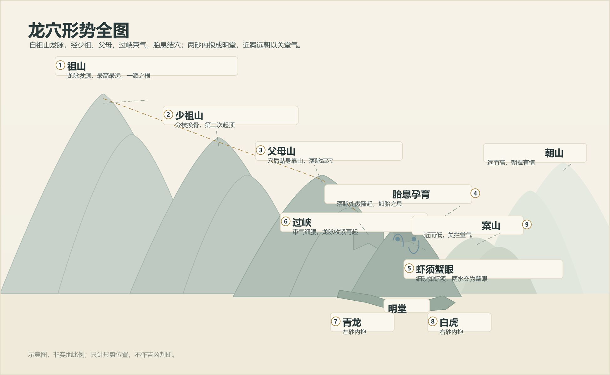
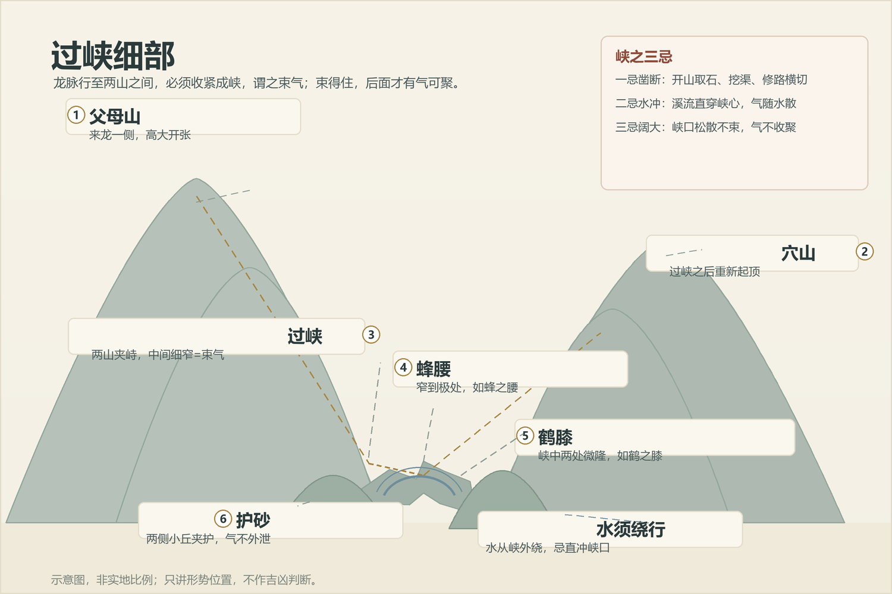
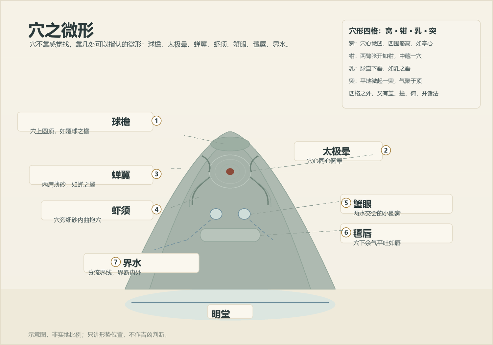

# 龙穴形势总图解

形家看地，先不看盘，只看一条线：**龙从哪里来，气在哪里止，水从哪里出，砂往哪里抱**。这条线串起来，就是下面这九个词。图先看，词后解，回头再对照图看一遍，基本就通了。

*点图可放大原图*

## 一、读图的顺序

自左向右，是一条龙脉的完整行程：

**祖山 → 少祖山 → 父母山 → 过峡 → 胎息孕育 → 虾须蟹眼 → 龙虎四势 → 案山朝山**

中间那个红点，是**穴**——龙气止聚之处。所有名词，都是围绕它展开的：往上是「怎么来」，往下是「怎么聚」，两边是「怎么护」，前面是「怎么关」。

## 二、九个词，一句一个

| 名词 | 位置 | 一句话要点 |
| --- | --- | --- |
| 祖山 | 龙脉最远处的最高峰 | 一派之根，决定这条龙的分量 |
| 少祖山 | 祖山之后、中途再起的高峰 | 分枝换骨，龙行到此重新起顶 |
| 父母山 | 穴后贴身那座山 | 穴的直接靠山，落脉结穴之所 |
| 过峡 | 父母山与穴山之间的细腰 | 束气之处，龙脉收紧再放 |
| 胎息孕育 | 落脉入穴前微微隆起处 | 如胎之息，气在此孕育成形 |
| 虾须蟹眼 | 穴旁极小的砂与水 | 细砂如虾须，两水交会处为蟹眼 |
| 青龙白虎 | 穴左右两列砂手 | 内抱成明堂，护住堂气不外泄 |
| 案山 | 明堂前方近处矮山 | 近而低，如几案，关拦堂气 |
| 朝山 | 案山之后更远的高山 | 远而高，朝揖有情，气象由此显 |

## 三、几个容易混的地方

**祖山与少祖山不是一座山。** 祖山是发源，往往很远、很高、看不见全貌；少祖是行龙过程中的第二次大起顶。一条长龙可以有多个少祖，但祖山只有一个源头。看地时先问「这条龙从哪座大山分下来」，再往下找少祖，就不会乱。

**父母山不是「父母」的比喻，是位置关系。** 它必须是**穴后直接靠的那一座**，中间隔着过峡也算连着。很多人把远处的高山叫父母山，那其实是少祖；父母山通常不高，但一定要「贴身」。

**过峡是吉凶的关口。** 龙脉行到过峡处必须束紧：两山夹峙、中间细窄，叫「束气」。过峡松阔、被水冲断、被路凿断，气就散了，后面再好的穴也虚。形家看地，过峡往往比穴本身更先看。

**胎息、虾须蟹眼是「微形」。** 这两样都在穴的脚边，尺度极小，肉眼容易忽略：胎息是落脉处那一点微隆，虾须是穴旁两缕细砂，蟹眼是两水交汇的两个小圆窝。它们决定了穴「有没有气」，是形家最见功夫的地方。

**龙虎不是「左青龙右白虎」这么简单。** 关键是**内抱**：两砂要弯向穴、兜住明堂，叫「有情」；直去、反飞、逼迫，叫「无情」。同一对砂，抱与不抱，格局完全不同。

**案山与朝山分工不同。** 案山近而低，作用在「关」——把堂气拦住不外泄；朝山远而高，作用在「望」——定气象、显贵格。有案无朝，堂气足而气象小；有朝无案，气象大而气不聚。

## 四、过峡要单独看细部

九项里，过峡最容易被一句「两山之间」带过去，其实它自己就是一个完整的小格局。放大看：

要看四点：

1. **夹**：两侧要有山或高地夹住，峡才成「峡」；一边空、一边敞，气就漏
2. **细**：中间越窄越好，窄到极处叫「蜂腰」
3. **隆**：峡中不是一路平直下去的，要有两处微微隆起，叫「鹤膝」——蜂腰鹤膝，是古书里形容好峡的标准词
4. **护**：峡两侧的小丘叫护砂，把气兜在峡里，不外泄

反面就是三条忌讳：**凿断**（开山取石、修路挖渠横切）、**水冲**（溪流直穿峡心）、**阔大**（峡口松松散散，束不住）。三条中了任何一条，气到峡这里就断，后面再好看的穴也是空壳。

这也是形家实地看地的顺序：先找过峡在不在、断没断，再谈穴。

## 五、穴有微形：看得见的「有穴无穴」

大格局看完了，最后落到方寸之间。真穴不是凭感觉说「这里气好」，而是有几处可以**指认**的微形。放大到穴心：

| 微形 | 位置 | 一句话要点 |
| --- | --- | --- |
| 球檐 | 穴上入首处 | 微微隆起如覆球之檐，是气入穴的门槛 |
| 太极晕 | 穴心 | 一圈圈同心圆晕，天然的层次纹，非人工可造 |
| 蝉翼砂 | 穴两肩 | 极薄的两缕砂，如蝉之翼，护住穴肩 |
| 虾须 | 穴两旁 | 两缕细砂内曲抱穴，如水之须 |
| 蟹眼 | 虾须尽头 | 两水交会的两个小圆窝，穴气由此界住 |
| 氊唇（毡唇） | 穴下 | 余气平吐如席之唇，是穴的「踏脚」 |
| 界水 | 蟹眼之外 | 分流界线，把穴内穴外分开 |
| 明堂 | 穴前 | 平展聚气处，大小深浅各有讲究 |

这八样加起来，形家叫「**穴证**」——证明此处真有穴的凭据。老话说「**葬乘生气**」，气看不见，但穴证看得见；穴证齐，气才有所附。

### 穴形四格：窝、钳、乳、突

认了穴，还要辨形。传统分四格：

- **窝**：穴心微凹，四围略高，像掌心托物
- **钳**：两臂张开如钳，中间藏一穴
- **乳**：脉直下垂，如乳之垂，穴在乳下
- **突**：平地微起一突，气聚于顶

四格是「形」的分类，落到具体还有**盖、撞、倚、并**四种葬法（气从上来叫盖，气从旁来叫撞，气偏一侧叫倚，两穴并立叫并）。这些是操作层面的东西，等读到《地理四弹子》案例卷再细究，这里先知道有这套分类就够了。

### 三个常见误判

1. **看见「钳」就点穴**：两臂张开不等于中间有穴，中间若无球檐、无晕、无唇，只是个空钳子
2. **把人工痕迹当太极晕**：晕是天然的同心纹，边界柔和、层次有渐变；人工平整过的地面，边界齐整、层次突变
3. **只看穴、不看界水**：界水不清，穴的范围就定不下来，容易「点偏」；蟹眼、界水是定界的坐标，不是装饰

### 一层提醒

这些名词各派叫法有出入（虾须蟹眼在有的体系里专指水，有的兼指砂），**以自己师承的口径为准**。图上用的是形家通行的用法：砂水兼指，重在「位置」而非「命名」。

## 六、这张图怎么用

- 拿它当**索引**：实地看到一处地形，先在图里找到对应的位置，再往细处看
- 拿它当**自查表**：九个位置有没有？哪一个断了、缺了、反了？先记事实，不下断语
- 拿它当**读书底图**：读《雪心赋》《入地眼》《人子须知》时，把书里的句子往这九个位置上放，放不进去的，多半是读错了

图上只标位置与关系，不标吉凶。形家的判断要靠实地尺度、方位、水流的综合，单看一张示意图，只能学到「词」和「序」，学不到「断」。

想看断法，回到书目那条线：先刘贲搭框架，再陈义霖对实照，最后用刘宝卿的讲义补断语口径。

---

*示意图为手绘性质，非实地比例；文中名词依传统形家通行用法，各派称呼略有出入，以师承体系为准。*
